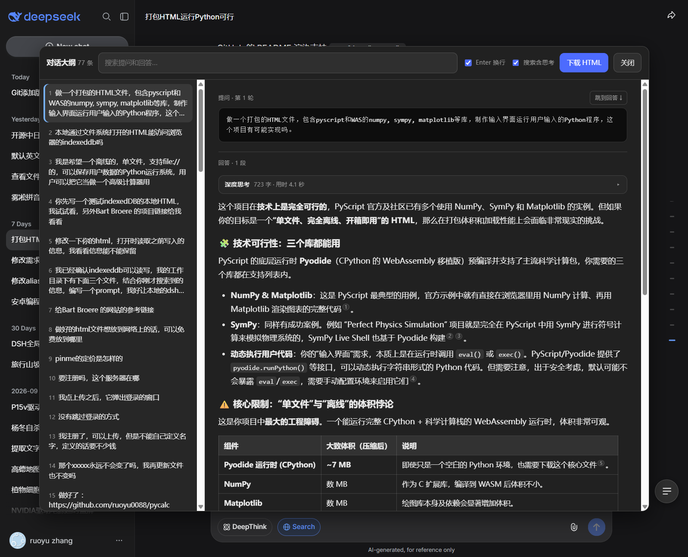
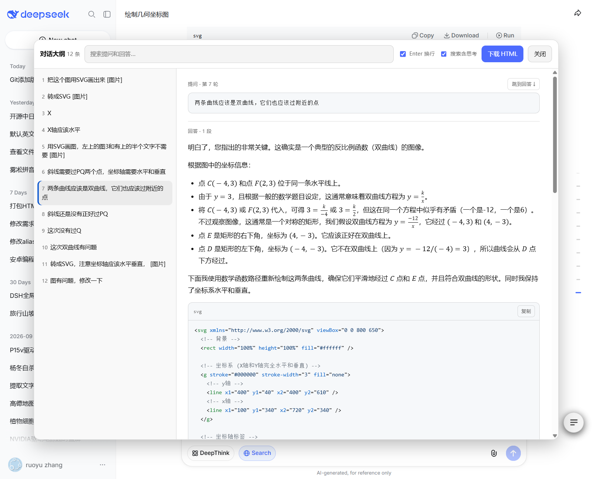

# DeepSeek 对话大纲（Chrome 扩展）

解决长对话里"想找自己之前问过的某个问题只能拼命往上滚"的问题：把当前 DeepSeek 对话的全部提问与回答做成一个可搜索、可离线保存的大纲。

这个项目是 [`chatgpt-conversation-outline`](../chatgpt-conversation-outline) 的 DeepSeek 版本：界面、Markdown 渲染、代码高亮、公式、导出与键盘接管都沿用同一套实现，数据采集与解析按 DeepSeek 的接口重写。





## 安装（一次性，只能手动点）

1. Chrome 地址栏打开 `chrome://extensions`
2. 右上角打开 **开发者模式**
3. 点 **加载已解压的扩展程序**，选择目录：`C:\Users\ruoyu\workspace\deepseek-conversation-outline\ext`
4. 打开任意 DeepSeek 对话页（`https://chat.deepseek.com/a/chat/s/…`），右下角会出现一个圆形按钮

> 双击 `安装扩展.bat` 可以直接帮你打开 `chrome://extensions` 和这个 `ext` 目录。
>
> 目录里的文件改了以后，回到 `chrome://extensions` 点该扩展的"刷新"图标即可生效。

## 使用

- 点右下角按钮 → 打开"对话大纲"面板。
- 左侧列出**本对话的全部提问**（过长会截断）；点某条提问，右侧上方显示**这条提问的完整内容**（代码框样式、保留换行，超长时框内滚动），右上角有「**跳到回答 ↓**」按钮。
- **深度思考默认折叠**：每条回答上方有一条「深度思考 · N 字 · 用时 N 秒」的条，点一下展开/收起。
- **代码块带语法高亮**（关键字/字符串/数字/注释/运算符等着色），左上角显示语言名，右上角有**复制按钮**（点一下复制整段代码，按钮会短暂显示"已复制"）。
- **联网检索的来源角标**：回答正文里的 `[reference:N]` 会渲染成可点的小圆标（①②③…），悬停显示来源标题，点击在新标签打开原网页。
- 上方搜索框：**同时搜提问和回答**；没命中的条目整条隐藏；命中的词在左右两侧都高亮；如果只有回答命中，该提问下方会显示"回答中命中 N 处"。
- **「搜索含思考」勾选框**（默认勾选）：控制搜索是否也匹配「深度思考」里的内容。勾选时，只有思考命中的条目也会显示"思考中命中 N 处"，并自动展开对应的思考块。
- **下载 HTML**：把整个对话导出成一个单文件 HTML（自带样式与高亮，离线打开后搜索框、复制按钮、折叠块都能用）。
- **关闭** / 按 `Esc` 关闭面板。

### 输入框：Enter 换行，Ctrl+Enter 发送

| 按键 | 行为 |
|---|---|
| `Enter` | 换行（原来会直接发送） |
| `Ctrl + Enter`（macOS `Cmd + Enter`） | 发送 |
| `Shift + Enter` | 换行（DeepSeek 原生行为，未改动） |

面板右上角有勾选框「**Enter 换行**」（默认勾选）：取消勾选就恢复 DeepSeek 原来的 Enter 提交行为。开关状态存在 `localStorage` 的 `ds-outline:enter-newline` 键里。输入法正在组字时（按 Enter 选候选词）不会被打断。

## 工作原理

1. **截获前端自己的请求**（`src/hook.js`，跑在页面主世界）：挂钩 `window.fetch` 和 `XMLHttpRequest`，把页面自己请求到的会话 JSON 留一份转发给界面。
2. **按需重取**（同样是只读 GET）：打开面板时按 `chat_session_id` 再取一次，避免"页面用了 IndexedDB 缓存、这一轮没发请求"导致面板空着。
3. **接口与字段**（实测，见 `recon/`）：

   ```
   GET /api/v0/chat/history_messages?chat_session_id=<uuid>
   Authorization: Bearer <localStorage.userToken.value>
   → {"code":0,"data":{"biz_data":{
        "chat_session":{id,title,...},
        "chat_messages":[{message_id, parent_id, role:"USER"|"ASSISTANT",
                          inserted_at, status, fragments:[...]}]}}}
   ```

   - **一次返回整个会话**（实测 154 条消息 / 1.4 MB 单次返回，没有分页），所以不需要 ChatGPT 版那套"向前翻页"逻辑。
   - **消息顺序按 `message_id`**，不能按 `inserted_at`：助手消息的时间戳有时比它的提问还早几十毫秒。
   - 正文在 `fragments[].content`（Markdown）。`fragment.type` 实测有：
     `REQUEST`（提问）、`THINK`（思考，带 `elapsed_secs`）、`RESPONSE`（回答）、
     `TOOL_SEARCH`/`TOOL_OPEN`（联网检索过程）、`TIP`（"AI 生成"免责声明）、`FILE`（附件）。
     面板只显示 REQUEST / THINK / RESPONSE / FILE，TIP 与 TOOL_* 跳过。
   - `RESPONSE.references[]` 是 `{id,type}`，id 能对到同一条消息里的 `TOOL_OPEN.result.url` —— 这就是来源角标的数据来源。

4. **整理成轮次**（`src/parse.js`）：按 `message_id` 排序，只接受 `USER`/`ASSISTANT`，每条用户消息开启一轮，其后的助手消息都算这一轮的回答（编辑/重新生成会产生多段回答，面板显示"N 段回答"）。用户消息只带附件时显示为 `[附件] 文件名`（图片为 `[图片]`）。
5. **渲染**（`src/markdown.js` + `vendor/prism/`）：自带轻量 Markdown → HTML，随后用 DOMParser 做白名单消毒；代码块用**打包在本地的 Prism** 高亮（31 个语言文件）；公式用**打包在本地的 KaTeX** 输出 MathML，由 Chrome 原生排版（不需要字体，导出的单文件也能离线看）。MV3 不允许加载远程脚本，所以库全部离线打包。
6. **导出**（`src/content.js`）：把面板数据序列化成一份带内联 CSS/JS 的 HTML，左列表 + 右详情、搜索、复制、折叠块都自带。

**只读**：扩展只发 GET 请求读对话数据，不发送消息、不修改任何对话、不向任何第三方上传数据，也不需要任何 Chrome 权限声明（`manifest.json` 里只有 content_scripts）。

## 文件

```
ext/manifest.json        MV3 清单（keymaps 隔离世界 / hook 主世界 / 面板脚本）
ext/src/keymaps.js       document_start：输入框 Enter/Ctrl+Enter 接管（隔离世界）
ext/src/hook.js          主世界：截获 fetch/XHR、按需重取历史（只读 GET）
ext/src/parse.js         纯逻辑：fragments → 提问/回答/思考/来源角标
ext/src/markdown.js      Markdown 渲染 + 消毒 + 公式 + 搜索高亮
ext/src/styles.js        界面样式 + 代码高亮配色（深色/浅色跟随页面）
ext/src/content.js       界面与交互：悬浮按钮、面板、搜索、代码高亮/复制、导出
ext/vendor/prism-config.js  Prism 手动模式 + 语言别名（py→python、js→javascript…）
ext/vendor/prism/           Prism 核心与 31 个语言文件（约 140KB，离线打包）
ext/vendor/katex/           KaTeX（约 275KB，离线打包，输出 MathML）
tools/                   开发期验证脚本（走 CDP，不影响扩展运行）
recon/                   抓包样本与验证产物（本地文件，不进版本库）
安装扩展.bat              打开 chrome://extensions 与 ext 目录
```

## 已知边界

- **代码高亮**：只有围栏标了语言、且该语言已打包（或能映射到已打包的语言名）才高亮；`text`/`plaintext` 等纯文本围栏不高亮。未打包的语言（Vue、Terraform、Dockerfile 等）按纯文本显示。
- **复制按钮**：在 https 页面用 `navigator.clipboard`；导出的本地 HTML 用 `file://` 打开时若浏览器不给剪贴板权限，会自动退化为"选中该代码块并提示按 Ctrl+C"。
- **Enter 接管**：依赖 DeepSeek 当前的输入框结构（聊天输入框是 `textarea`，同一容器里有 `div[role="button"].ds-button--primary` 作发送按钮）。DeepSeek 大改版后如果失效，改 `ext/src/keymaps.js` 里的选择器即可。
- **换行的实现**：DeepSeek 的输入框是 React 受控 `<textarea>`，所以换行是"改原型 value setter + 派发 input 事件"。`document.execCommand('insertText')` 虽然能改 DOM，但进不了 React 状态（实测发送出去的正文里没有换行），所以只作为兜底。
- **思维链**：默认折叠；导出页里用原生 `<details>` 折叠。搜索时是否匹配由「搜索含思考」开关控制（存在 `ds-outline:search-thinking`）。
- **来源角标**：只支持正文里的 `[reference:N]`；`TOOL_SEARCH` 类引用（没有具体 URL 的）只显示编号，不可点。
- **公式**：支持 `\(…\)`、`$…$`（行内）与 `$$…$$`、`\[…\]`（块级）。DeepSeek 实测主要用 `\(…\)`。渲染不了的写法会退回原始文本（灰字），不会报错。公式内部不参与搜索高亮，但搜索索引仍用原始 LaTeX 文本。
- **附件**：只显示文件名占位，不下载附件本体。
- **对话分支**：编辑/重新生成产生的所有消息都会进同一个轮次，所以一轮下可能出现多段回答。
- **需要联网**：面板打开时会请求一次历史数据；离线时只能看到已经截获到的部分。

## 开发期验证（tools/）

这些脚本通过 Chrome DevTools Protocol 驱动一个**已登录 DeepSeek 的调试 Chrome**（`tools/launch_debug.py` 会启动并加载扩展）：

```powershell
$PY = "C:\pixi_env\.pixi\envs\default\python.exe"
$env:MKL_THREADING_LAYER = "TBB"

& $PY tools/launch_debug.py --url "https://chat.deepseek.com/"   # 起调试 Chrome + 加载扩展
& $PY tools/recon_deepseek.py 9222 --status                       # 看当前页面/登录态/会话链接
& $PY tools/recon_deepseek.py 9222 --capture                      # 抓页面自己的请求到 recon/
& $PY tools/probe_api.py 9222 --limit 8                           # 会话接口探针（消息数/fragment 类型）
& $PY tools/dump_conv.py 9222 <sessionId>                         # 存一份完整会话 JSON
& $PY tools/test_real.py 9222 --download                          # 真扩展：面板/搜索/下载/Enter
& $PY tools/test_key.py 9222                                      # Enter 换行、Ctrl+Enter 发送、开关
& $PY tools/test_features.py 9222                                 # 复制按钮、跳到回答、搜索高亮
& $PY tools/test_render.py 9222 <sessionId>                       # 逐轮渲染统计（代码/公式/表格）
& $PY tools/check_export.py 9222 recon/export-test.html --search Pyodide   # 导出文件体检
& $PY tools/shot_panel.py 9222 recon/shot.png --select 3           # 截图
```

### 测试的安全网（重要）

被测页面是"能真发消息的页面"，所以每个碰输入框/按钮的脚本都遵守：

1. **先堵住网络出口**：把 `fetch` / `XMLHttpRequest.send` 的非 GET 请求拦下并记录（`window.__dsBlockedPosts`，含请求体），所以 Ctrl+Enter 只会产生"被拦截的发送尝试"。
2. **按键用 CDP 可信事件**：`Input.dispatchKeyEvent` / `Input.insertText`，`evaluate` 出来的合成 KeyboardEvent 测不出默认行为。
3. **复制按钮用真实鼠标点击**（`Input.dispatchMouseEvent`）：JS 的 `.click()` 没有用户激活，Chrome 会拒绝 `clipboard.writeText`。
4. 每个阶段重新加载页面，避免上一阶段"被拦截的发送"把页面留在奇怪状态。

### 已验证（2026-11-03，Chrome 156 / Windows）

- **真扩展路径**（`Extensions.loadUnpacked`，不是注入）：`#ds-outline-host` 在隔离世界挂载、主世界 `__dsOutlineHook` 生效、面板拿到 77 轮；点「下载 HTML」真的落盘 1,875,204 字节（77 个 panel / 335 个代码块 / 77 个折叠块 / 1 个内联脚本 / 0 个外链）。
- **对话「打包HTML运行Python可行」**（154 条消息 / 77 轮）：列表 77 条；搜 `Pyodide` → 33/77 条、正文 9 处高亮、列表 2 处；徽标形如"回答中命中 9 处 · 思考中命中 4 处"。
- **对话「绘制几何坐标图」**（24 条消息 / 12 轮）：11 个代码块、7430 个高亮片段、181 个 `<math>`（可见的 66 个宽度均非零，兜底 0 个）。
- **SVG 代码块**：修复了从 ChatGPT 版继承的一个 bug —— `stripCustomTags()` 在"摘出围栏代码块"之前执行，会把代码里的 `<rect/>`、`<path/>` 当组件标签删掉（表现为 SVG 代码块只剩注释）。现在先摘代码块/行内代码，再处理组件标签。
- **键盘接管**（真扩展 + 已堵住发送）：`Enter` → 输入框变两行、光标落在新行、发送按钮仍可用、无发送请求；接着输入的文字落在第二行；`Ctrl+Enter` → 发出 `POST /api/v0/chat/completion`（被拦住），请求体里 `prompt` 为 `"第一行\n第二行"`（换行确实进了 React 状态）；关掉开关后 `Enter` 恢复原生提交。
- **复制按钮**（真实鼠标点击）：按钮显示"已复制"，系统剪贴板内容与代码块一致（Windows 把 `\n` 变成 `\r\n`）。
- **跳到回答**：详情区 `scrollTop` 0 → 110.8。
- **导出页**（`file://` 打开）：搜 `Pyodide` → 33/77 条、236 处高亮、19 个思考块自动展开；点条目后页面回到顶部、对应 panel 显示；清空搜索后折叠块全部收起。
- **SPA 切换**：面板开着时点侧边栏另一个会话，面板会自动取回新对话（`/` → `/a/chat/s/68d0…`，0 条 → 1 条）。
- **浅色主题**：DeepSeek 切到 light 后页面底色 `rgb(255,255,255)`，面板自动加 `.ho-light`，对比度正常。
